# Rationality of the center of a generic division algebra with a group action over a field of characteristic 0

Lean 4 companion to the paper with the same title.

Let `F` be a field of characteristic `0`, and let `H = C₃ × C₃` act regularly as a transitive
subgroup of `S₉`. Let `Z_H(F,9)` be the center of the generic division algebra of degree `9` with
H-action. Problem 5.2 of the Auel--Brussel--Garibaldi--Vishne problem list asks for its birational
class. The paper computes the integral cohomology group `H²(H, M|_H) ≅ C₉` of the restricted
Procesi lattice and shows that its exponent `9` is incompatible both with quasi-permutation and
with every finite-index permutation superlattice, while every permutation lattice has exponent
dividing `3`. Consequently `M|_H` is neither quasi-permutation nor stably permutation, and its
flasque class is not the class of an invertible lattice.

**Whether `Z_H(F,9)` is rational, stably rational, or retract rational is left open** in the
paper. Passing from those integral obstructions to a rationality verdict would require the
*untwisted* forms of the Endo--Miyata and flasque-class criteria; the literature supplies these
criteria only for twisted invariant fields, and they fail in general for the fields `F(M)^G`
(Remark 2.7 of the paper recalls the standard counterexample). For `H = Cₚ × Cₚ` inside `S(p²)`
with `p` odd the same computation gives `H²(H, M|_H) ≅ C_{p²}` against exponent `p`; there too no
rationality verdict is claimed.

This repository contains the Lean 4 development of the surrounding chain: the lattice
computations, the statement layers, and the wiring from the named inputs to the conclusions.
What is checked here, and the status of the classical criteria that the paper no longer uses, is
listed under *Verification status* below and in the status note at the end.

## Paper

The paper is included in this repository:

* `paper/ABGV-5.2-resolution.tex` — LaTeX source (version of 2026-10-23);
* `paper/ABGV-5.2-resolution.pdf` — the compiled PDF (22 pages).

The PDF was compiled from the TeX source of 2026-10-23. This revision states the rationality
type of `Z_H(F,9)` as **open** — the lattice-theoretic results (`H²(H, M|_H) ≅ C₉`, exponent
`3` for permutation lattices, `M|_H` neither quasi-permutation nor stably permutation,
`ρ(M|_H)` not invertible) are unchanged — replaces the two untwisted criteria by a remark
recording that only their twisted forms are available, and cites Snider's theorem explicitly.
See the status note at the end of this file.

## Verification code

The two verification programs (Python and GAP with HAP) and their recorded output are shipped
in `verification/` for reproducibility. They are **no longer part of the paper** (the appendix
that used to contain them has been removed). Re-run with `verification/run.sh`; details in
`verification/README.md`.

## Verification status

* The development compiles with **no `sorry`**, and every declaration depends only on the
three standard axioms `propext`, `Classical.choice`, `Quot.sound`.
* **Named hypotheses** carried over from the earlier draft, *not* reproved: the
Endo--Miyata--Voskresenskii criterion (`EMHyp` for the H-level form, `EMHypP` for the
p-general form) and the retract-rationality criterion (`RetractCriterionHyp`,
`ABGV52/RetractCrit_ABGV52.lean`); each is a type-locked interface with a wiring theorem and a
non-vacuity probe. **The paper no longer asserts either criterion in the untwisted setting**
(Remark 2.7), so these interfaces are now documentation of what the *twisted* theorems give and
of the gap between them and the untwisted fields, rather than hypotheses of a paper theorem.
Saltman's Corollary 3.13 is likewise no longer quoted in the paper; the type-locked interface
`SaltmanHyp` is kept for the Saltman track.

## Dependency graph

The graph below is the dependency graph of the H2 layer (the Procesi identification). Blue nodes
are self-authored theorems, green dashed nodes are mathlib lemmas used directly, and an arrow
points from a lemma to the statement that uses it.

```mermaid
graph BT
  root["H2: Z_S9(F,9) ≅ F(M ⊕ U)^S9"]
  h2unc["h2_unconditional"]
  nv9["nonempty_genericDivisionData_two_nine"]
  h2sm["h2_of_scalarMem"]
  smz["scalarMemZHypK'"]
  nv2["nonempty_genericDivisionData_two"]
  simp["isSimpleRing_UDK'_of_scalarMem"]
  nvspan["nonempty_genericDivisionData_of_span"]
  hspan["adjoin_genericMatrix_map_eq_top"]
  ideal["udk'_ideal_inf_scalars"]
  nvac["exists_scalar_mem_of_ne_bot"]
  cor148["exists_scalar_map_of_mem_genericCenter_of_span"]
  clear["exists_clear_den"]
  centimg["mem_centerImage_of_map_eq_scalar"]
  scalarm["scalar_mem_sprAlgebraK_of_mem_subring"]
  detmap["det_phiS_map_ne_zero"]
  spralg["mem_sprAlgebraK_iff"]
  centk["psiSpr_center_scalar"]
  centiff["mem_genericCenter_iff"]
  mcenter2["exists_eq_scalar_of_mem_matrixCenter"]
  mcenter["matrixCenter_eq_bot"]
  dets["det_phiS_ne_zero"]
  detpsi["det_psi_ne_zero"]
  phimap["phiS_map_evalAt"]
  lam["lam_injective"]
  m_induct["Algebra.adjoin_induction"]
  m_inv["Matrix.nonsing_inv_mul"]
  m_mapdet["RingHom.map_det"]
  m_cent["Subalgebra.mem_center_iff"]
  m_det["Matrix.det_kronecker ＋ det_vandermonde"]
  m_pow["Matrix.map_pow ＋ diagonal_pow/mul_diagonal"]
  m_cent -.-> centiff
  centiff --> centimg
  centk --> centimg
  m_induct -.-> clear
  m_cent -.-> cor148
  m_induct -.-> cor148
  mcenter2 --> cor148
  dets --> detmap
  m_mapdet -.-> detmap
  lam --> detpsi
  m_det -.-> detpsi
  detpsi --> dets
  m_mapdet -.-> dets
  phimap --> dets
  simp --> h2sm
  h2sm --> h2unc
  smz --> h2unc
  detmap --> hspan
  m_inv -.-> hspan
  m_pow -.-> hspan
  nvac --> ideal
  m_cent -.-> mcenter
  mcenter --> mcenter2
  hspan --> nv2
  nvspan --> nv2
  nv2 --> nv9
  cor148 --> nvspan
  m_pow -.-> phimap
  centk --> scalarm
  spralg --> scalarm
  ideal --> simp
  centimg --> smz
  clear --> smz
  m_induct -.-> smz
  scalarm --> smz
  spralg --> smz
  classDef self fill:#dbeafe,stroke:#1e40af,stroke-width:1px;
  classDef ml fill:#dcfce7,stroke:#166534,stroke-dasharray:3 2;
  classDef root fill:#fde68a,stroke:#92400e,stroke-width:2px;
  class root,h2unc,nv9,h2sm,smz,nv2,simp,nvspan,hspan,ideal,nvac,cor148,clear,centimg,scalarm,detmap,spralg,centk,centiff,mcenter2,mcenter,dets,detpsi,phimap,lam self;
  class m_induct,m_inv,m_mapdet,m_cent,m_det,m_pow ml;
  class root root;
```

Each theorem name below links to its declaration in the Lean sources.

* `Procesi/Cor148.lean` — [exists_scalar_map_of_mem_genericCenter_of_span](https://github.com/wuzhengyao/abgv52-lean/blob/main/Procesi/Cor148.lean#L40), [nonempty_genericDivisionData_of_span](https://github.com/wuzhengyao/abgv52-lean/blob/main/Procesi/Cor148.lean#L96)
* `Procesi/GenericMatrix.lean` — [exists_eq_scalar_of_mem_matrixCenter](https://github.com/wuzhengyao/abgv52-lean/blob/main/Procesi/GenericMatrix.lean#L148), [matrixCenter_eq_bot](https://github.com/wuzhengyao/abgv52-lean/blob/main/Procesi/GenericMatrix.lean#L136), [mem_genericCenter_iff](https://github.com/wuzhengyao/abgv52-lean/blob/main/Procesi/GenericMatrix.lean#L94)
* `Procesi/GenericSpan.lean` — [det_phiS_ne_zero](https://github.com/wuzhengyao/abgv52-lean/blob/main/Procesi/GenericSpan.lean#L147), [det_psi_ne_zero](https://github.com/wuzhengyao/abgv52-lean/blob/main/Procesi/GenericSpan.lean#L101), [lam_injective](https://github.com/wuzhengyao/abgv52-lean/blob/main/Procesi/GenericSpan.lean#L45), [phiS_map_evalAt](https://github.com/wuzhengyao/abgv52-lean/blob/main/Procesi/GenericSpan.lean#L123)
* `Procesi/H2Final.lean` — [psiSpr_center_scalar](https://github.com/wuzhengyao/abgv52-lean/blob/main/Procesi/H2Final.lean#L2843)
* `Procesi/Nonvacuous.lean` — [adjoin_genericMatrix_map_eq_top](https://github.com/wuzhengyao/abgv52-lean/blob/main/Procesi/Nonvacuous.lean#L52), [det_phiS_map_ne_zero](https://github.com/wuzhengyao/abgv52-lean/blob/main/Procesi/Nonvacuous.lean#L36), [nonempty_genericDivisionData_two](https://github.com/wuzhengyao/abgv52-lean/blob/main/Procesi/Nonvacuous.lean#L128), [nonempty_genericDivisionData_two_nine](https://github.com/wuzhengyao/abgv52-lean/blob/main/Procesi/Nonvacuous.lean#L135)
* `Procesi/PI/CentralIdeal.lean` — [exists_scalar_mem_of_ne_bot](https://github.com/wuzhengyao/abgv52-lean/blob/main/Procesi/PI/CentralIdeal.lean#L185)
* `Procesi/ScalarMemZ.lean` — [exists_clear_den](https://github.com/wuzhengyao/abgv52-lean/blob/main/Procesi/ScalarMemZ.lean#L176), [mem_centerImage_of_map_eq_scalar](https://github.com/wuzhengyao/abgv52-lean/blob/main/Procesi/ScalarMemZ.lean#L34)
* `Procesi/Statement.lean` — [H2:  Z_{S9}(F,9) ≅ F(M⊕U)^{S9}](https://github.com/wuzhengyao/abgv52-lean/blob/main/Procesi/Statement.lean#L127)
* `Procesi/UDKScalarMem.lean` — [h2_unconditional](https://github.com/wuzhengyao/abgv52-lean/blob/main/Procesi/UDKScalarMem.lean#L248), [scalarMemZHypK'](https://github.com/wuzhengyao/abgv52-lean/blob/main/Procesi/UDKScalarMem.lean#L135), [scalar_mem_sprAlgebraK_of_mem_subring](https://github.com/wuzhengyao/abgv52-lean/blob/main/Procesi/UDKScalarMem.lean#L75)
* `Procesi/UDKSimple.lean` — [h2_of_scalarMem](https://github.com/wuzhengyao/abgv52-lean/blob/main/Procesi/UDKSimple.lean#L111), [isSimpleRing_UDK'_of_scalarMem](https://github.com/wuzhengyao/abgv52-lean/blob/main/Procesi/UDKSimple.lean#L58), [udk'_ideal_inf_scalars](https://github.com/wuzhengyao/abgv52-lean/blob/main/Procesi/UDKSimple.lean#L42)
* `Procesi/UDKSpan.lean` — [mem_sprAlgebraK_iff](https://github.com/wuzhengyao/abgv52-lean/blob/main/Procesi/UDKSpan.lean#L51)
* mathlib: [Algebra.adjoin_induction](https://leanprover-community.github.io/mathlib4_docs/find/?pattern=Algebra.adjoin_induction#doc), [Matrix.nonsing_inv_mul](https://leanprover-community.github.io/mathlib4_docs/find/?pattern=Matrix.nonsing_inv_mul#doc), [RingHom.map_det](https://leanprover-community.github.io/mathlib4_docs/find/?pattern=RingHom.map_det#doc), [Subalgebra.mem_center_iff](https://leanprover-community.github.io/mathlib4_docs/find/?pattern=Subalgebra.mem_center_iff#doc), [Matrix.det_kronecker ＋ det_vandermonde](https://leanprover-community.github.io/mathlib4_docs/find/?pattern=Matrix.det_kronecker#doc), [Matrix.map_pow ＋ diagonal_pow/mul_diagonal](https://leanprover-community.github.io/mathlib4_docs/find/?pattern=Matrix.map_pow#doc)

## Status note (2026-10-23): the paper no longer claims a rationality verdict

The paper (`paper/ABGV-5.2-resolution.tex`, commit "paper: state the
rationality type of Z_H as OPEN (conservative route)") now states only the
*lattice-theoretic* results — `H^2(H, M|_H) ≅ C_9`, `exp(H^2(H,P)) | 3` for
permutation `P`, `M|_H` is neither quasi-permutation nor stably permutation,
and `rho(M|_H)` is not the class of an invertible lattice — and explicitly
leaves open whether `Z_H(F,9)` is rational, stably rational, or retract
rational.

What changed, and what it means for this Lean development:

* `thm:endo-miyata` (the untwisted implication "stably rational implies
  quasi-permutation") is **no longer a paper theorem**; the paper now carries
  `rem:untwisted-criteria`, which records that the literature supplies the
  criterion only for *twisted* invariant fields and that the untwisted form
  fails in general (`G = C₂×C₂`, `M = M₂(G)`: the center is rational by
  Snider while `eta(M₂(G)) ≠ 0`).
* `thm:retract-criterion` (untwisted "retract rational iff `rho(M)` is
  invertible") became `rem:twisted-criterion` for the same reason, and
  `thm:not-retract-rational` became `prop:rho-not-invertible` (its proof is
  unchanged — it is purely lattice-theoretic).
* `thm:not-stably-rational` became `rem:open-verdicts`.

Consequently the named hypothesis `EMHyp` in `ABGV52/EM_ABGV52.lean` (and the
`SaltmanHyp`-style hypotheses attached to the retract criterion) formalise
statements that the paper has withdrawn. They remain useful as a record of
*what the twisted theorems do and do not give*, but they must not be read as
hypotheses of a paper theorem. A decision (keep as illustrative material, or
retire) is left to the author.

## Build

The toolchain is `leanprover/lean4:v4.35.0` (see `lean-toolchain`) and the
development is pinned to mathlib4 commit
`aa35a481e5f0cdb3b04a899ead15d6ca7305a624` (see `lakefile.toml`) — an
upgrade of 2026-10-15 from `db584cd6d46c92f209a44c0f1c829460d327499d`
(2026-08-10) and Lean 4.33.

    lake build

(The prebuilt-object cache of the mathlib community was not usable at the
time of the upgrade; `lake build` compiles mathlib locally, which takes
roughly half an hour on a 20-core machine with sufficient memory.)

`SHA256SUMS` records the SHA-256 of every Lean source file.
